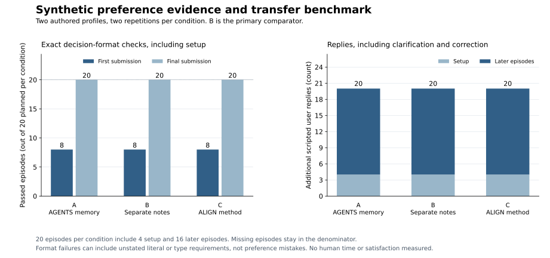

# Synthetic preference evidence and transfer

ALIGNS did not reduce scripted replies in this synthetic experiment. All three conditions
used 20 additional replies and passed all 20 final exact artifact checks.
The prespecified benefit rule was not met.

Those numbers need a qualification: a postrun audit classified all 36 correction
rounds as representation repairs, with 12 in each condition. Some later prompts
omitted the exact literals or JSON types required by the scorer. These counts
cannot be read as 36 preference misunderstandings. No human satisfaction,
active time, or cognitive workload was measured.



## What was compared

Two authored profiles covered community event planning and an internal export
service. Each trajectory had five episodes: setup with a substantive plan,
a temporary exception, transfer with a lasting change, later reuse with a new
choice, and a neutral calculation. Two repetitions under three conditions gave
12 trajectories and 60 episodes, including 12 setup and 48 later episodes.
Setup costs and output quality are included.

| Condition | Persistent memory |
| --- | --- |
| A | Explicit instructions to read and maintain authorized criteria in AGENTS.md. |
| B | The same memory practice in a separate PREFERENCES.md. |
| C | ALIGNS.md plus the frozen ALIGNS skill and recurring-use method. |

C versus B was primary; C versus A was secondary. All conditions received the
same project records, permissions, available answers, model settings, and reply
limits. A and B received competent instructions for preserving exceptions,
updating confirmed criteria, and avoiding unnecessary questions. Initial
records mixed explicit standing criteria with incidental details. This tests
extracting and applying scattered evidence, handling changes, and resolving
missing consequential choices. It does not test discovering unspoken
preferences or represent a sample of human users.

Each episode began a fresh conversation and retained the trajectory's files,
including the initial source records. A separate Astra classifier routed
natural questions to a fixed answer inventory without condition labels or
actor notes. The installed environment excluded installation, client discovery,
and method-update costs. The
[frozen protocol](benchmarks/discovery/results/2026-10-15-astra-v1/source-snapshot/benchmarks/discovery/README.md)
and [cases](benchmarks/discovery/results/2026-10-15-astra-v1/source-snapshot/benchmarks/discovery/cases.json)
define the full comparison.

## Frozen counts

The [offline verification](benchmarks/discovery/results/2026-10-15-astra-v1/verification.json)
replays the complete matrix. Each condition contains four setup episodes and
16 later episodes. First submission means the first deliverable after any
clarification, not necessarily the first turn.

| Measure | A: AGENTS | B: notes | C: ALIGNS |
| --- | ---: | ---: | ---: |
| Exact checks passing on first submission | 8/20 | 8/20 | 8/20 |
| Exact checks passing on final submission | 20/20 | 20/20 | 20/20 |
| Setup exact checks passing on first submission | 4/4 | 4/4 | 4/4 |
| Later exact checks passing on first submission | 4/16 | 4/16 | 4/16 |
| Additional setup replies | 4 | 4 | 4 |
| Additional later replies | 16 | 16 | 16 |
| Total additional replies | 20 | 20 | 20 |
| Correction rounds, included above | 12 | 12 | 12 |
| Supplied criterion units | 42 | 44 | 46 |
| Repeated criterion units | 14 | 16 | 18 |
| Repeated units in answers to questions | 2 | 1 | 2 |
| Neutral episodes passed / additional replies | 4/4 / 0 | 4/4 / 0 | 4/4 / 0 |
| Execution failures / protocol errors | 0 / 0 | 0 / 0 | 0 / 0 |

A criterion unit is an authored criterion ID supplied in a message or the
initial evidence. Corrections can repeat several units in one reply. Temporary
exceptions and lasting changes supplied in task requests count toward total
units; they do not themselves count as repeated units. These measures include
format corrections and cannot be treated as a pure count of preference errors.

Every trajectory used five replies: one at setup, one at the exception, one
at the lasting change, and two at reuse with clarification. The neutral task
used none. Each trajectory therefore tied its matched baselines on replies.

Each paired cell below shows replies / supplied units / final exact passes.

| Profile and repetition | A | B | C |
| --- | --- | --- | --- |
| Community, repetition 1 | 5 / 10 / 5 of 5 | 5 / 12 / 5 of 5 | 5 / 12 / 5 of 5 |
| Community, repetition 2 | 5 / 10 / 5 of 5 | 5 / 11 / 5 of 5 | 5 / 12 / 5 of 5 |
| Service, repetition 1 | 5 / 11 / 5 of 5 | 5 / 10 / 5 of 5 | 5 / 11 / 5 of 5 |
| Service, repetition 2 | 5 / 11 / 5 of 5 | 5 / 11 / 5 of 5 | 5 / 11 / 5 of 5 |

For both comparisons, C had zero wins, four ties, and zero losses on replies.
On supplied units, C versus B had zero wins, two ties, and two losses; C versus
A had zero wins, two ties, and two losses. The cumulative reply count per
trajectory was 1, 2, 3, 5, 5. Cumulative supplied units across each condition
were A: 18, 26, 34, 42, 42; B: 17, 26, 36, 44, 44; C: 18, 28, 38, 46, 46.
There was no observed setup payback in reply counts.

The benefit rule required at least 20% fewer replies and one fewer reply per
trajectory, no increase in repeated units or neutral-task replies, all C
outputs passing exact and substantive checks, and completed audits. Both
comparisons had 0% fewer replies and zero fewer replies per trajectory. C also
had more repeated units. The numerical requirements failed regardless of the
separate semantic review. These were descriptive thresholds, not significance
tests or validated thresholds of human benefit.

## Why exact checks failed

The frozen scorer required exact field values and JSON types. Later tasks
repeated field names without always repeating their accepted representation.
Examples include the service's `failure_output` literal `actionable-text`, the
event allocation literal `lottery`, and a boolean for `public_attendee_names`.
An agent could express the intended criterion in prose, a structured object,
or an empty attendee list and still fail the exact check.

The [correction ledger](benchmarks/discovery/results/2026-10-15-astra-v1/correction-classification.json)
classifies all 60 additional replies: 24 information answers and 36 schema-only
corrections. A separate methods-review agent inspected these after the run,
with condition labels visible. It classified none as a change in intended
preference or decision. This is a postrun diagnostic, not a revised endpoint
or a blinded quality score. All original failures and correction costs remain
in the primary totals. Differences in corrected fields also affect the unit
counts, so those differences do not establish that one condition understood
preferences better.

## Separate semantic review

Two condition-blind Astra reviewers assessed all 60 episode packets in 12
completed batches. The
[review replay](benchmarks/discovery/results/2026-10-15-astra-v1/review-verification.json)
verified packet reconstruction, recorded responses, model identity, and scores
without missing batches. A substantive pass required both criterion fit and a
useful explanation. Each reviewer assessed first and final submissions
separately under the
[frozen rubric](benchmarks/discovery/results/2026-10-15-astra-v1/source-snapshot/benchmarks/discovery/review-rubric.md).

| Review outcome | A | B | C |
| --- | ---: | ---: | ---: |
| First substantive passes, reviewer 1 | 19/20 | 20/20 | 17/20 |
| First substantive passes, reviewer 2 | 15/20 | 16/20 | 15/20 |
| Final substantive passes, reviewer 1 | 19/20 | 20/20 | 20/20 |
| Final substantive passes, reviewer 2 | 19/20 | 20/20 | 20/20 |
| Routes judged correct, reviewer 1 | 8/8 | 7/8 | 8/8 |
| Routes judged correct, reviewer 2 | 8/8 | 8/8 | 7/8 |

The reviewers disagreed on 12 checks: ten first-submission criterion-fit checks
and two routing checks. The ten artifact disagreements concerned whether an
otherwise correct decision in a different JSON representation should pass.
They also agreed on three C first-submission failures for returning an array
where a boolean had been specified; their reasons acknowledged the correct
privacy meaning. These scores therefore remain partly sensitive to format,
even in the semantic review. Both sets of scores and reasons are retained;
none was replaced with the more favorable judgment.

Both reviewers rejected one A final explanation in
[service repetition 2, reuse](benchmarks/discovery/results/2026-10-15-astra-v1/review-packets/p364e1e211f841bea.json).
It described the importer's former 30-day support window as an exception,
although the authorized exception concerned the runtime package. The numerical
choice of seven days was correct, but the explanation invented a historical
policy distinction. B and C had no final substantive failures under either
reviewer. This isolated finding does not establish a general quality advantage.

The two disputed routes concerned conditional package authorization: the
answer supplied a latency target that made the hypothetical exception
unnecessary, and the reviewers differed on whether restating the dependency
rule adequately answered the question. These are unresolved disagreements,
not unanimously established routing errors. They prevent clearing the routing
validity requirement, independently of the already unmet numerical benefit
rule. The
[complete comparison](benchmarks/discovery/results/2026-10-15-astra-v1/judgments/comparison.json)
retains the evidence and reasons. Neither reviewer found an off-interface
request for user input.

The reviewers used the actor's model family and may share its biases. They
worked in separate sessions within this maintainer evaluation; this is not
external replication or a measure of human approval.

## Resources and text

| Resource | A | B | C |
| --- | ---: | ---: | ---: |
| Actor calls | 40 | 40 | 40 |
| Actor duration, summed seconds | 799.426 | 822.230 | 908.777 |
| Actor input tokens | 3,059,516 | 3,089,667 | 3,676,842 |
| Actor output tokens | 26,878 | 27,704 | 31,474 |
| Question-classifier calls | 8 | 8 | 8 |
| Classifier duration, summed seconds | 63.153 | 57.802 | 65.081 |
| Classifier input tokens | 98,002 | 98,059 | 98,094 |
| Classifier output tokens | 489 | 421 | 498 |

Input totals include cached input tokens; cached tokens are not added again.
The actor run took 946.356 seconds with three workers. Summed durations are
not wall-clock duration or user time. C used more actor tokens in this run;
this small experiment does not establish general speed or monetary cost.
Separate review resources are excluded from this table. The 12 review calls
used 436,757 input tokens and 63,794 output tokens, with 1,251.119 summed
seconds. The [review manifest](benchmarks/discovery/results/2026-10-15-astra-v1/judgments/manifest.json)
and [batch records](benchmarks/discovery/results/2026-10-15-astra-v1/judgments/batches)
retain those separate resource receipts.

Each condition received 10,218 initial user-message characters and 2,430 source
file characters across its four trajectories. Replies contained 2,406, 2,354,
and 2,534 characters for A, B, and C. The condition instructions contained
1,412, 1,428, and 1,452 characters respectively; C also had 6,168 characters of
ALIGNS instruction blocks. Static file counts count each initial file once per
trajectory, not every model reread. All conditions had 14,580 added protocol
characters in actor prompts. The
[plotted values and text breakdown](assets/benchmarks/discovery-comparison.json)
record Unicode-character counts and source hashes. They are not token estimates
or measures of reading effort.

## Execution and evidence

The actor and question classifier used `gpt-6-astra` at medium reasoning effort
through Codex CLI `0.162.0-alpha.17.2`. The
[freeze commit](https://github.com/hmmhmmhm/aligns.md/commit/0975de3a3ee967dc6d1c2aeb5c0893ec61c5ac83)
and [public CI receipt](https://github.com/hmmhmmhm/aligns.md/actions/runs/38665066430),
created at 2026-10-15 01:20:01 UTC, preceded the
[run manifest](benchmarks/discovery/results/2026-10-15-astra-v1/manifest.json)
at 01:20:23.747517 UTC. The source verification confirms the frozen files did
not change during execution. All 12 trajectories completed; no failed cell
was replaced.

The [observable-action audit](benchmarks/discovery/results/2026-10-15-astra-v1/side-channel-audit.json)
inspected 246 assistant messages, including 126 non-final messages, and 55
note changes. It found no off-interface user requests, hidden-answer reads,
or unauthorized lasting preferences in the published traces. The audit was
unblinded and performed within the maintainer evaluation. It does not establish
complete filesystem isolation. The archive retains recovered tool errors,
prompts, source files, replies, snapshots, traces, redaction records, and
failures; credentials and private reasoning are excluded.

Before scored execution, engineering checks exposed lexical routing problems.
The same checks were reused to assess a semantic replacement, so they are not
held-out evidence of general routing accuracy. The initial criteria were
explicit, the choices were bounded, the tasks were short, and the synthetic
user gave consistent answers. Two repetitions are not independent human
participants. The [earlier effort pilot](EFFORT_BENCHMARK.md) remains a separate
published tie; these results are not pooled with it. A claim about actual user
effort needs a separate study with consenting people and measured setup,
maintenance, workload, useful output, and abandoned tasks.

## Reproduce

Replay the actor evidence offline:

```sh
python3 benchmarks/discovery/verify.py \
  benchmarks/discovery/results/2026-10-15-astra-v1 \
  --output /tmp/align-discovery-verification.json
```

Replay the model-review evidence using absolute paths. The frozen review
verifier requires resolved absolute archive paths on systems with symlinked
temporary directories.

```sh
python3 benchmarks/discovery/verify_reviews.py \
  "$PWD/benchmarks/discovery/results/2026-10-15-astra-v1" \
  --packets "$PWD/benchmarks/discovery/results/2026-10-15-astra-v1/review-packets" \
  --reviews "$PWD/benchmarks/discovery/results/2026-10-15-astra-v1/judgments" \
  --output /tmp/align-discovery-review-verification.json
```

Generate the chart from the verified archive report. The
[plotting utility](benchmarks/discovery/reporting/plot.py) was added after the
run and changes no scoring rules. It used Python 3.14.7 and Matplotlib 3.11.2;
[SVG](assets/benchmarks/discovery-comparison.svg),
[PNG](assets/benchmarks/discovery-comparison.png), and
[data](assets/benchmarks/discovery-comparison.json) are available.

```sh
python3 benchmarks/discovery/reporting/plot.py \
  benchmarks/discovery/results/2026-10-15-astra-v1/verification.json
```
