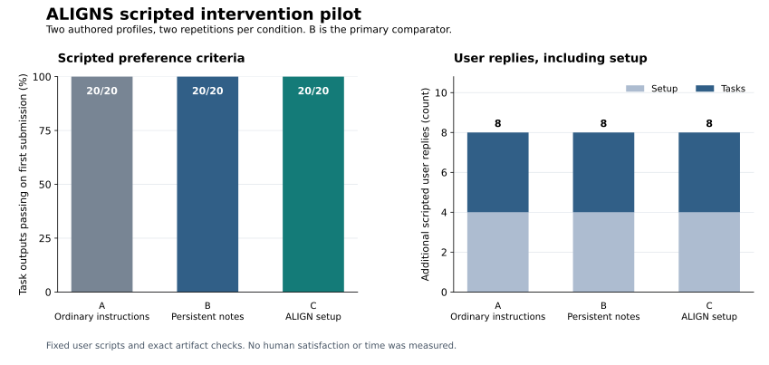

# Scripted user intervention pilot

ALIGNS and both baselines tied in this pilot. Every condition produced 20 of 20 task outputs that met the scripted user's criteria on the first submission, with eight additional user replies and no repeated preference explanations or corrections. The pilot found no reduction in scripted intervention burden from ALIGNS.



These are exact checks against authored preference profiles and task requirements, including the output schema and supplied body text. No people rated their satisfaction, and no human time or cognitive workload was measured. The [earlier behavioral pilot](BENCHMARK.md) is a separate experiment with different outcomes.

## What was compared

Two profiles covered notice preparation and small website implementation choices. Each trajectory contained setup and five tasks: routine work, a temporary exception, reuse in another context, a lasting change, and a new choice that required asking the user. Three conditions ran twice per profile, giving 12 trajectories, 72 episodes, and 60 task outputs.

| Condition | Setup |
| --- | --- |
| A: ordinary instructions | Shared instructions with permission to save preferences in project files. No ALIGNS skill. |
| B: persistent notes | The same shared instructions plus an explicit instruction to read and maintain PREFERENCES.md. No ALIGNS skill. |
| C: ALIGNS setup | The same shared instructions plus ALIGNS.md, the align skill, and its recurring-use instructions. |

C versus B was the frozen primary comparison. C versus A was secondary. A already received guidance to reuse answers, save authorized preferences, preserve temporary exceptions, and ask about unresolved choices. Its final project snapshots contained only AGENTS.md and output.json; it did not create ALIGNS.md. It is one competent instruction baseline, not a representative sample of agent harnesses. Every condition could retain project files and received identical preference answers and permission to save them.

Each episode began a fresh conversation. Follow-up replies stayed in that episode's conversation; later episodes received the saved project files without the earlier transcript. The user was a fixed response script. The same named preference questions and exact answers were available in all conditions. Task-specific option IDs required applying preferences, and the last task required a new question even if a guess would select the correct answer.

The environment was already installed and identified Codex as the primary client. The costs below include preference setup and maintenance, but exclude installation, client discovery, and method updates. The [frozen protocol](benchmarks/effort/results/2026-10-15-astra-v2/source-snapshot/benchmarks/effort/README.md) and [cases](benchmarks/effort/results/2026-10-15-astra-v2/source-snapshot/benchmarks/effort/cases.json) specify the conditions and checks.

## Results

Each condition contains four trajectories, four setup episodes, and 20 task episodes. Counts include every planned trajectory.

| Measure | A: ordinary | B: notes | C: ALIGNS |
| --- | ---: | ---: | ---: |
| Task outputs passing on first submission | 20/20 | 20/20 | 20/20 |
| Final task outputs passing | 20/20 | 20/20 | 20/20 |
| Setup episodes passing | 4/4 | 4/4 | 4/4 |
| Setup user replies | 4 | 4 | 4 |
| Task user replies | 4 | 4 | 4 |
| Total additional user replies | 8 | 8 | 8 |
| Supplied preference units, setup | 12 | 12 | 12 |
| Supplied preference units, tasks | 12 | 12 | 12 |
| Total supplied preference units | 24 | 24 | 24 |
| Repeated preference units | 0 | 0 | 0 |
| Correction rounds | 0 | 0 | 0 |
| Protocol errors or failed episodes | 0 | 0 | 0 |
| Actor calls | 32 | 32 | 32 |

A preference unit is one preference ID supplied in a user message. A batched answer can contain several units while costing one reply. Task units include the explicit temporary exception and lasting change in the initial task prompts, as well as the newly requested choice. Initial prompts themselves are counted in the text totals below; reply counts describe additional messages after those prompts.

First submission means the first attempted deliverable, after any necessary clarification. It does not mean completing the task in the first turn. Each condition completed 16 of 20 tasks without a follow-up; the remaining four correctly asked the required new-choice question before submitting. Those questions are necessary work, not corrections to a bad draft.

Every trajectory reached the protocol's minimum of two replies and six preference units: one batched setup reply containing three preferences, two preference changes supplied in task prompts, and one answer to the later unresolved choice. The baselines left no remaining scripted burden for C to reduce on these tasks.

### Paired results

Each cell shows additional replies / supplied preference units / passed task outputs. Setup is included in the first two counts.

| Profile and repetition | A | B | C |
| --- | --- | --- | --- |
| Notices, repetition 1 | 2 / 6 / 5 of 5 | 2 / 6 / 5 of 5 | 2 / 6 / 5 of 5 |
| Notices, repetition 2 | 2 / 6 / 5 of 5 | 2 / 6 / 5 of 5 | 2 / 6 / 5 of 5 |
| Website choices, repetition 1 | 2 / 6 / 5 of 5 | 2 / 6 / 5 of 5 | 2 / 6 / 5 of 5 |
| Website choices, repetition 2 | 2 / 6 / 5 of 5 | 2 / 6 / 5 of 5 | 2 / 6 / 5 of 5 |

Both comparisons have zero wins, four ties, and zero losses on preference units and reply counts. All trajectories also shared the same cumulative costs:

| Through episode | Replies per trajectory | Preference units per trajectory |
| --- | ---: | ---: |
| Setup | 1 | 3 |
| Routine task | 1 | 3 |
| Temporary exception | 1 | 4 |
| Reuse in another context | 1 | 4 |
| Lasting change | 1 | 5 |
| New unresolved choice | 2 | 6 |

The decision rule required at least a 20% reduction in both preference units and replies, at least one fewer reply per trajectory, no increase in repeated preference units, and all C tasks passing without execution failures. Both comparisons showed 0% reductions and zero fewer replies. C passed the quality requirement but did not meet the benefit threshold. These were prespecified descriptive thresholds, not statistical significance tests.

## Text and resource counts

All conditions received 17,380 scripted user-message characters: 1,238 in setup requests, 1,996 in setup replies, 13,662 in initial task requests, and 484 in task replies. The harness added 15,288 protocol characters per condition, reported separately. These counts describe this script, not the effort required to compose or read an equivalent real conversation.

| Resource total | A | B | C |
| --- | ---: | ---: | ---: |
| Actor duration, summed seconds | 374.994 | 444.627 | 499.024 |
| Input tokens | 1,457,159 | 1,252,807 | 2,052,165 |
| Output tokens | 6,433 | 5,022 | 10,285 |

Input totals include cached input tokens; cached tokens are not added again. C used more tokens in this run. These are descriptive totals from one small experiment, without a general speed or dollar-cost claim. The complete run took 479.156 seconds with three workers and 96 actor calls.

## Execution and evidence

The actor was `gpt-6-astra` at medium reasoning effort through Codex CLI `0.162.0-alpha.17.2`. The [v2 freeze commit](https://github.com/hmmhmmhm/aligns.md/commit/1386c5ecf79924e4337066e3d9fa5af812001e53) and [public CI receipt](https://github.com/hmmhmmhm/aligns.md/actions/runs/38661382573), created at 2026-10-15 00:40:36 UTC, preceded the actor manifest at 00:40:52.236141 UTC. The [manifest](benchmarks/effort/results/2026-10-15-astra-v2/manifest.json) records exact source hashes, the randomized schedule, model, CLI binary hash, limits, and isolation settings.

All 12 v2 trajectories completed. No failed behavioral attempt was replaced. The [offline verification](benchmarks/effort/results/2026-10-15-astra-v2/verification.json) replays prompts, scripted replies, artifact checks, session boundaries, and metrics from the public evidence. Its automated review flags non-final assistant messages for separate inspection. A [fresh model review of the public archive](benchmarks/effort/results/2026-10-15-astra-v2/external-reader-review.md) checked all 185 assistant messages, including 89 non-final messages, and found no questions outside the scripted interface. The [audit record](benchmarks/effort/results/2026-10-15-astra-v2/side-channel-audit.json) also records no observed hidden-answer reads in the visible tool actions. This separate model session is a maintainer evidence check, not an external replication. The traces contain recovered tool errors; none caused a failed episode or a replacement run.

The initial protocol was frozen at [df5752f](https://github.com/hmmhmmhm/aligns.md/commit/df5752f4155480ef11f4b03932e47d7474ca2ac7), with a [public CI receipt](https://github.com/hmmhmmhm/aligns.md/actions/runs/38661098866) created at 2026-10-15 00:37:35 UTC. The [v1 infrastructure failure](benchmarks/effort/results/2026-10-15-astra-v1-failed/failure-report.md) stopped all 12 trajectories before any actor call. Its zero replies and zero completed episodes are retained and are not behavioral measurements. The [infrastructure correction](benchmarks/effort/infrastructure-correction.md) fixed ancestor-instruction isolation and publication scanning before the separate v2 run. The cases, answers, thresholds, and skill were unchanged. V1 and v2 are not pooled.

The public archive retains observable prompts, responses, tool actions, snapshots, timings, failure records, and redaction manifests. Credentials and private reasoning are excluded. Network access was disabled, and each trajectory used a separate HOME and CODEX_HOME. The operating-system sandbox still allowed some reads outside the fixture; this is not complete filesystem isolation.

## Limits and further validation

This maintainer-authored experiment used two constrained profiles on one model and client. The tasks supplied preference question IDs, encouraged batching, and offered consistent corrective feedback. They primarily test structured elicitation, retention, and application after the relevant dimensions are known. They provide little evidence about discovering unstated preferences or handling difficult judgment calls. Two repetitions are not independent human participants.

The tie does not establish that every alignment method or harness is equivalent. It shows no additional benefit from the complete ALIGNS setup over these baselines on these tasks. A separate model reviewer inspecting public evidence is still part of a maintainer evaluation; it is not an independent external replication or a study of user satisfaction.

The [preference-evaluation notes](benchmarks/effort/reporting/preference-evaluation-notes.md) discuss published methods and a separately frozen next experiment. Claims about actual effort need the [real-user validation plan](benchmarks/effort/README.md#real-user-validation), including setup and maintenance time, participant workload, deliverable quality, and abandoned tasks. No such participants were recruited for this pilot.

## Reproduce the report

Offline verification needs Python 3.9 or later and no model access:

```sh
python3 benchmarks/effort/verify.py benchmarks/effort/results/2026-10-15-astra-v2 \
  --output /tmp/align-effort-verification.json
```

The chart uses the same verified counts. Its [plotting script](benchmarks/effort/reporting/plot.py), [dependency versions](benchmarks/effort/reporting/plot-requirements.txt), [plotted values and provenance](assets/benchmarks/effort-comparison.json), and [PNG](assets/benchmarks/effort-comparison.png) are available. The plotting utility was added after the run and does not change the frozen scoring rules.

```sh
python3 benchmarks/effort/reporting/plot.py /tmp/align-effort-verification.json
```
