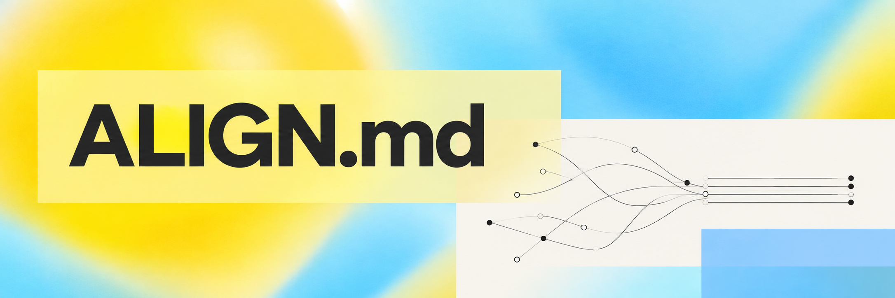
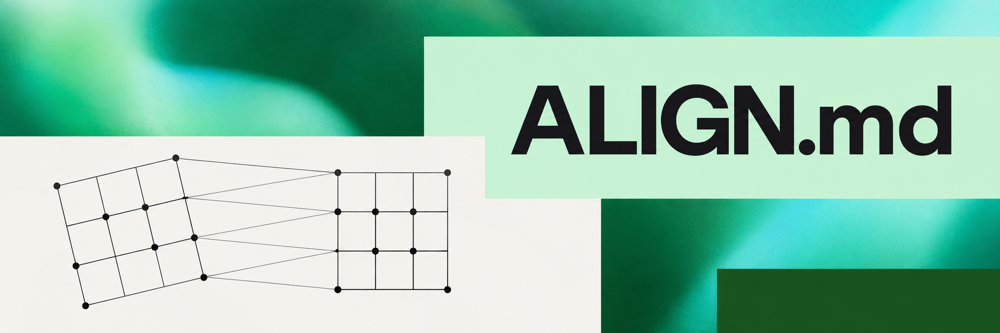

<p align="center">
  
</p>

<h1 align="center">ALIGN.md</h1>

<p align="center">
  <a href="LICENSE"></a>
  <a href="https://github.com/hmmhmmhm/align.md/stargazers"></a>
  <a href="#install-align"></a>
  <a href="https://skills.sh/hmmhmmhm/align.md/align"></a>
</p>

## Define what good means

ALIGN.md records the goals and trade-offs you want your agent to use. The **align** skill helps you agree on those criteria and revisit them as the work changes.

<p align="center">
  
</p>

## Keep expectations separate

Keep personal criteria in ALIGN.md and the reusable alignment method in the skill. Connect the agreement through your primary agent instruction file, such as AGENTS.md or CLAUDE.md. Use Git history when available. Updating the skill never rewrites your agreement.

<p align="center">
  
</p>

## Continuous self-alignment

Return to alignment when an important decision misses your intent, repeated corrections reveal a missing criterion, or you are unsure what to do next. Before a long autonomous run, rehearse a few hypothetical choices. Clear errors get fixed directly; settled questions stay settled.

<p align="center">
  
</p>

## Install align

Paste this request into your agent. It sets up the maintained skill and an update
policy, then connects it to your project.

```text
Set up the maintained align skill from https://github.com/hmmhmmhm/align.md for this project. Read its current installation guide, check the existing installation and agent instructions, and use the supported installation route for my primary CLI. Ask which CLI I mainly use, and whether it is this one, only if that is unclear.

Enable supported automatic method updates. If the client has no native auto-update option, use a targeted update at the start of each alignment session, preserving the installation scope. Keep a working installed version when offline. Explain which update mode is active; do not add a scheduler or update unrelated packages.

Use the skill to establish or review ALIGN.md and connect the primary instruction file to it. Preserve existing rules and distinct files; propose safe links for any other clients I use. Record the invocation and update policy in ALIGN.md. Reuse clear answers, and suggest a focused alignment check after important judgment mismatches, before untested long autonomous work, or when I am unsure of the next direction. Method updates must never rewrite my personal criteria or count as agreement.
```

Or install the portable skill directly:

```sh
npx skills add hmmhmmhm/align.md --skill align
```

Then ask: **Use the align skill to set up ongoing alignment for this project.**

Native plugin installation is available for Codex and Claude Code. Claude Code
can update this marketplace automatically when enabled. Other routes can use a
user-authorized update at the start of an alignment session. No background
updater or universal automatic activation is assumed.

[Installation and updates](docs/usage.md) · [Behavioral benchmark](BENCHMARK.md) · [Intervention pilot](EFFORT_BENCHMARK.md) · [Preference transfer](DISCOVERY_BENCHMARK.md) · [Preference retention](RETENTION_BENCHMARK.md) · [Validation](docs/validation.md) · [Distribution](docs/distribution.md)

## License

[MIT](LICENSE). Copyright (c) 2026 hmmhmmhm.

<p align="center">
  
</p>
