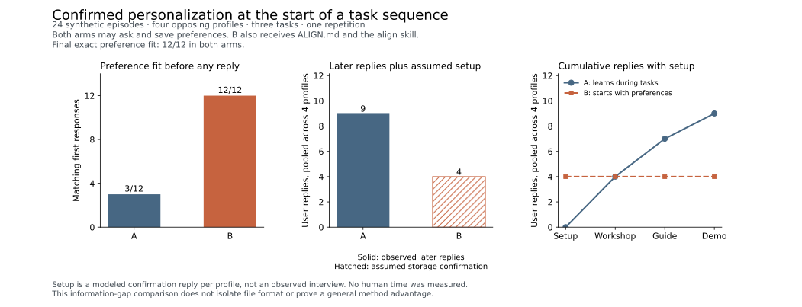

# Confirmed preference retention pilot

An agent starting with confirmed personal criteria needed no clarification
replies across 12 synthetic tasks. The same agent with generic instructions
and permission to learn and save preferences needed nine replies. Both arms
produced matching first submissions after clarification and matching final
submissions in all 12 tasks. A separate condition-masked model review passed
all submitted plans under the frozen content rubric.

The initialized package received information that the baseline initially
lacked. It also received the align skill and its retrieval instructions. This
result describes that package in a narrow synthetic workload. It does not
isolate ALIGNS.md's file name, establish superiority over equally informed
AGENTS.md or another memory system, or measure human effort. The earlier
[information-equivalent preference-transfer study](DISCOVERY_BENCHMARK.md)
remains a separate tie.



## What was compared

Four authored profiles cross two preferences: one workflow in depth or a
survey of several workflows, and advanced instruction or first-use teaching.
Every combination fits the stated task budget. Each profile receives a
workshop, guide, and demo task in that order, with a fresh conversation for
each task. There is one repetition, giving 24 episodes across the two arms.
These are synthetic profiles, not human participants.

A starts with generic AGENTS.md and the current task. B starts with the same
instructions and task, plus confirmed preferences from an authored earlier
conversation in ALIGNS.md, the align skill, and its instruction block. Both
retain workspace files across tasks and may ask questions or save confirmed
preferences. A can therefore acquire and reuse the criteria during the run.
Neither receives the earlier conversation itself.

Every task includes the full response schema and allowed values. Questions
use ordinary language plus explicit scope/audience topic IDs. The scripted
user supplies only the requested criteria; corrections would supply only
mismatching criteria. This bounded interface does not test open-ended
preference discovery. Each episode permits three replies and four actor calls.
The [frozen protocol and cases](benchmarks/retention/results/2026-10-15-astra-v1/source-snapshot/benchmarks/retention)
contain the complete design and authored prior conversations.

## Observed outcomes

Zero-reply fit requires the first response to be a valid submission matching
both preferences. A question does not count as a matching submission, even
when asking is appropriate. First-submission fit allows clarification before
the first deliverable. These measures answer different questions.

| Measure | A: learns during tasks | B: initialized preferences and method |
| --- | ---: | ---: |
| Zero-reply preference fit | 3/12 | 12/12 |
| First-submission exact fit, after any clarification | 12/12 | 12/12 |
| Final exact fit | 12/12 | 12/12 |
| Later user replies | 9 | 0 |
| Clarification replies | 9 | 0 |
| Preference corrections | 0 | 0 |
| Formatting corrections | 0 | 0 |
| Repeated authored criterion units | 18 | 0 |
| Runtime failures / unresolved episodes | 0 / 0 | 0 / 0 |

All nine baseline replies supplied both criteria. Four were initial
clarifications, one per profile; five were later requests for criteria already
supplied within the same trajectory. All 18 units repeat criteria from the
authored prior conversation, but only ten units repeat information delivered
to A earlier in this run. The unit definition must not be read as nine instances
of forgetting information already in the baseline's conversation history.

The paired reply counts were:

| Profile | Preferences | A: workshop / guide / demo | B: workshop / guide / demo |
| --- | --- | ---: | ---: |
| P1 | Focused, experienced | 1 / 1 / 1 | 0 / 0 / 0 |
| P2 | Focused, newcomer | 1 / 0 / 0 | 0 / 0 / 0 |
| P3 | Broad, experienced | 1 / 1 / 0 | 0 / 0 / 0 |
| P4 | Broad, newcomer | 1 / 1 / 1 | 0 / 0 / 0 |

A saved preferences in every trajectory. P1 and P4 used
LEARNING_PREFERENCES.md but asked again on both later tasks. P2 updated
AGENTS.md after the workshop and reused it immediately. P3 updated AGENTS.md
after the guide and reused it for the demo. This variation includes retrieval
behavior and the timing of saving, not just whether storage was permitted.
The [evidence audit](benchmarks/retention/results/2026-10-15-astra-v1/reporting/evidence-audit.md)
checks those writes and reads against native traces.

## Setup and cumulative replies

The authored prior conversation contains one user reply per profile in both
workflows. It is a common sunk cost. B additionally assumes one reply approving
storage, or four pooled replies. That confirmation and the deterministic file
construction were modeled; no setup interview or installation session was run.

Including this assumed incremental setup cost, pooled cumulative replies are
A: 4, 7, 9 and B: 4, 4, 4 after workshop, guide, and demo. The arms break even
after the first task. After all three tasks, the total is nine observed replies
for A versus four assumed setup replies for B. Including the common authored
prior conversation would make the totals 13 and eight.

Payback depends on the assumed cost. The sensitivity below reports the first
later task where saved replies meet or exceed setup cost. It is descriptive
reply accounting, not a measured return on human time.

| Assumed setup replies per profile | P1 | P2 | P3 | P4 | Pooled |
| --- | --- | --- | --- | --- | --- |
| 0 | Workshop | Workshop | Workshop | Workshop | Workshop |
| 1 | Workshop | Workshop | Workshop | Workshop | Workshop |
| 2 | Guide | Not reached | Guide | Guide | Demo |
| 3 | Demo | Not reached | Not reached | Demo | Not reached |

The zero-cost row uses the protocol's first-later-task convention. No setup
cost remains to recover before that task. Installation, reading, maintenance,
changes in preferences, and abandoned work were not measured. No reply count,
text length, token count, or model duration is converted to human minutes.

## Substantive review

A fresh reviewer configured as gpt-6-astra at medium effort read 24 shuffled
packets without condition labels or the result key. It assessed scope,
audience, and rationale for first and final submissions separately. All
24 first and 24 final submissions passed. Within each packet, first and final
text was identical because no submission required correction.

This was a maintainer-run model review, not external human validation. Actual
response text was preserved, so storage references to AGENTS.md or
LEARNING_PREFERENCES.md could reveal clues to condition. The reviewer treated
storage claims as unverified from text alone; the separate trace audit checks
persistence. Its model setting is recorded from the subagent configuration,
without an independently archived CLI model receipt for the reviewer.

The reviewer noted one plan that promised a single meeting example but later
introduced a second scenario. Both teach the same capture workflow, so it
passed the frozen workflow-scope criterion. This minor inconsistency remains
visible in the [review limitations](benchmarks/retention/results/2026-10-15-astra-v1/review/limitations.md).
The rubric did not separately score actual teaching feasibility or fictional
interface accuracy. The [review replay](benchmarks/retention/results/2026-10-15-astra-v1/review-verification.json)
reconstructs all packets and verifies 152 quoted excerpts against the submitted
text. It verifies evidence provenance, not the correctness of model judgments.

## Execution, recovery, and resources

Actors used Codex CLI 0.162.0-alpha.17.2 with gpt-6-astra and medium reasoning.
The [freeze commit](https://github.com/hmmhmmhm/aligns.md/commit/c07a880fd10d2f007c5bf1851070062819284571)
and its [CI receipt](https://github.com/hmmhmmhm/aligns.md/actions/runs/38676751600),
created at 03:31:58 UTC on 2026-10-15, preceded the original run manifest at
03:32:04 UTC. Frozen source hashes remain unchanged.

The user paused the study for unrelated site work. At interruption, eight
actor calls in seven episodes had native completion receipts. Their outputs
and workspaces were retained. The orchestrator had not saved subprocess
stdout, stderr, exit codes, timeout receipts, prompt-audit stdout, or
intermediate workspace snapshots for those calls. Those fields remain null.
Native completion establishes model-turn completion; it cannot reconstruct
missing process receipts.

After the user resumed, the [recovery procedure](benchmarks/retention/recovery/README.md)
was [committed and pushed](https://github.com/hmmhmmhm/aligns.md/commit/d6b7bc5)
before further actor calls. It reconstructed the completed responses from
native traces, continued P2/A from its exact saved workspace at the guide,
and ran the five untouched chains. No completed response was rerun or replaced.
The [execution lineage](benchmarks/retention/results/2026-10-15-astra-v1/execution-lineage.json)
records the original trace hashes. The completed matrix has 33 actor calls in
24 fresh task conversations: eight recovered calls and 25 resumed calls.

| Resource | A | B |
| --- | ---: | ---: |
| Actor calls | 21 | 12 |
| Native input tokens, all calls | 420,132 | 303,435 |
| Native output tokens, all calls | 5,634 | 3,621 |
| Native task duration, summed seconds | 310.795 | 197.566 |
| Calls missing subprocess duration | 2 | 6 |

Native token counters are differenced between completed turns in each session,
then summed. Cached input is already included in input tokens. Resumed CLI
receipts can repeat cumulative counters, so their raw sums are retained in
[resource evidence](benchmarks/retention/results/2026-10-15-astra-v1/resources.json)
but are not reported as consumed-token totals. Native task duration and
subprocess duration are different measurements. Full uninterrupted wall time
is unavailable. These figures exclude semantic review and do not establish a
general compute or speed advantage.

The separate unblinded evidence auditor checked all 33 responses, delivered
replies, 21 command executions, four preference writes, and 15 commentary
messages. It found no observed off-interface user request, hidden-answer read,
or unauthorized preference write. This is an observable-action audit, not a
complete filesystem isolation guarantee. Private reasoning, credentials,
identity fields, host paths, and account quota metadata are excluded from
publication; private originals remain retained.

## Reproduce the evidence checks

The recovery-aware verifier binds all responses and prompts to native traces
and replays the frozen scoring and reply policy. Its only adaptation to the
frozen exact verifier is explicit handling of unavailable subprocess durations.
The original verifier alone cannot process those null resource fields. An
early replay made before the last chain finished reported the incomplete
matrix; that diagnostic remains archived separately from the passing final
verification.

```sh
PYTHONDONTWRITEBYTECODE=1 python3 benchmarks/retention/recovery/verify.py \
  benchmarks/retention/results/2026-10-15-astra-v1 \
  --output /tmp/align-retention-verification.json

PYTHONDONTWRITEBYTECODE=1 python3 benchmarks/retention/reporting/verify_review.py \
  benchmarks/retention/results/2026-10-15-astra-v1 \
  --output /tmp/align-retention-review-verification.json
```

The [chart utility](benchmarks/retention/reporting/plot.py) generates the
[SVG](assets/benchmarks/retention-comparison.svg),
[PNG](assets/benchmarks/retention-comparison.png), and
[plotted data](assets/benchmarks/retention-comparison.json) from verified counts.
It is reporting code added after execution and changes no scoring rules.

The tasks are short learning-material plans, the criteria are explicit and
stable, the answer interface is bounded, and there is one run per profile.
The result supports fewer scripted clarification replies for this initialized
package. A broader study would need varied tasks, preference changes, equally
informed memory controls, and measured setup and maintenance with consenting
human users.
